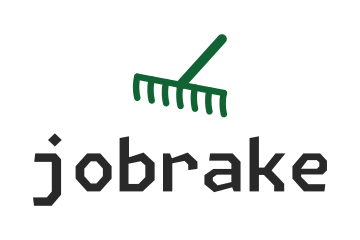

<div align="center">
  <picture>
    <source media="(prefers-color-scheme: light)" srcset="https://raw.githubusercontent.com/eyayaw/jobrake/refs/heads/main/docs/assets/logo/svg/jobrake-stacked-color.svg">
    <source media="(prefers-color-scheme: dark)" srcset="https://raw.githubusercontent.com/eyayaw/jobrake/refs/heads/main/docs/assets/logo/svg/jobrake-stacked-dark.svg">
    
  </picture>
</div>

___The job boards shed new postings every day. Bring a rake.___

jobrake is a Python package and CLI tool for fetching job postings from LinkedIn, Indeed, StepStone,
AEA JOE, AcademicTransfer, EconJobMarket, INOMICS, UN Careers, and employers' boards on
[major](#supported-job-boards) applicant tracking systems.
It returns each posting as a record with the same fields, whichever site it came from.

> Read it as "**job-rake**".
>
> Say it quickly and you hear "**job break**"—a break from the search doomscroll. (^_~)
>
> _Did **Jo** show up? **Jo** hit the **brake**, too._

<table>
<tr>
<td valign="top" width="50%">

```sh
jobrake linkedin search \
  --query economist \
  --location Germany \
  --results 1 \
  --details
```

</td>
<td valign="top" width="50%">

```sh
jobrake greenhouse search \
  --board anthropic
```
</td>
</tr>
</table>

The LinkedIn search writes this record, shown here with its description and logo URL cut short:

```json
[
  {
    "site": "linkedin",
    "id": "4491606986",
    "url": "https://de.linkedin.com/jobs/view/senior-researcher-f-m-x-health-economics-at-wifor-institute-4491606986",
    "title": "Senior Researcher (f/m/x) Health Economics",
    "company": "WifOR Institute",
    "locations": [
      {
        "name": "Darmstadt, Hesse, Germany",
        "city": "Darmstadt",
        "country_code": "DE",
        "latitude": 49.87245,
        "longitude": 8.6510105
      }
    ],
    "date": "2026-11-19",
    "description": "Dein zukünftiger Job?\nUnsere Business Unit Health Economics erforscht ...",
    "company_url": "https://de.linkedin.com/company/wifor",
    "company_logo": "https://media.licdn.com/dms/image/v2/C4D0BAQHzEHqMu92Yew/company-logo_200_200/...",
    "employment_type": "full_time",
    "posted_at": "2026-11-19T14:10:11.000Z",
    "expires_at": "2027-11-19T14:10:11.000Z",
    "apply_type": "offsite",
    "applicants": 25,
    "education": "bachelor degree"
  }
]
```

Every site gives the same keys, as [the record](https://github.com/eyayaw/jobrake/blob/main/docs/reference.md#the-record)
describes, and leaves out a detail it does not have.

## Installation

jobrake is not on PyPI. Install it from GitHub with [`uv`](https://github.com/astral-sh/uv):

```sh
# Try it without installing
uvx --from git+https://github.com/eyayaw/jobrake jobrake -h
# Install as a CLI tool
uv tool install git+https://github.com/eyayaw/jobrake
# Add it to a project as a library
uv add git+https://github.com/eyayaw/jobrake
```

jobrake needs the Python version that `requires-python` in its `pyproject.toml` names, and
`uv tool install` fetches one when your system lacks it.
Releases before 1.0 can break the API, so pin a tag in a project:
`uv add git+https://github.com/eyayaw/jobrake --tag <tag>`.
The [changelog](https://github.com/eyayaw/jobrake/blob/main/CHANGELOG.md)
marks each breaking change.

## Usage

### CLI

Every command has the form `jobrake <site> <command>`.
Each site has `search`, and some add `postings`, which fetches postings you already know, or a
lookup that turns a name into the ID a search takes.
`jobrake -h` lists the sites, `jobrake <site> -h` a site's commands, and
`jobrake <site> <command> -h` their options. `jobrake --version` prints the version.

```sh
# LinkedIn ----
## Search
jobrake linkedin search \
        -q "research economist" \
        -l "London, England" \
        -n 5 \
        -a 24 \
        -d \
        -o jobs.csv

## Fetch details
# You can pass several urls/ids
jobrake linkedin postings \
        "https://uk.linkedin.com/jobs/view/senior-data-scientist-at-hm-treasury-4461975556"
        # or just 4461975556
## Resolve place names
jobrake linkedin places "amsterdam" # then use the display name in search
                                    # -l "Amsterdam, North Holland, Netherlands"
# Use the geoId of the place directly (instead of location)
jobrake linkedin search -q "data scientist" -g 102011674 -n 2 # Amsterdam, Netherlands

# Indeed ----
## Search, details included
jobrake indeed search \
        -q "data analyst" \
        -c gb \
        -l "London" \
        -n 5 \
        -a 24 \
        -o jobs.jsonl
# Resolve place names
jobrake indeed places -c nl "amsterdam"

# StepStone ----
## Engineering jobs within 50 km of Munich, each with its description
jobrake stepstone search -q Ingenieur -l München -r 50 -n 20 -d

# Greenhouse ----
## Every posting on one employer's board
jobrake greenhouse search -b airbnb -o airbnb.csv

# EconJobMarket ----
## Every open ad
jobrake econjobmarket search -o ejm.csv

# AEA JOE ----
## Labor economics listings posted this week
jobrake aea search --jel J --max-age-hours 168

# INOMICS ----
## Postdocs in Germany, each with its description
jobrake inomics search -c de --category postdoc -d

# AcademicTransfer ----
## Scientific vacancies in economics, newest first
jobrake academictransfer search -q economics --vacancy-type scientific
```

A site takes only the options its server applies, so `-h` shows a different list on each.
The options that several sites share keep one meaning:

| Option                  | Effect                                                                         |
| ----------------------- | ------------------------------------------------------------------------------ |
| `--query`, `-q`         | Job title or keywords                                                          |
| `--results`, `-n`       | The most postings to return: 10 on Indeed and LinkedIn, 20 on Workday, 100 on the other sites that take it |
| `--max-age-hours`, `-a` | Only postings this many hours old or newer. No age limit by default            |
| `--radius`, `-r`        | The search radius around `--location`, in kilometers                           |
| `--details`, `-d`       | Fetch each posting's page for the fields its card lacks, such as the description |
| `--output`, `-o`        | Write a new file instead of stdout. An existing file is an error               |
| `--format`, `-f`        | `json`, `jsonl`, or `csv`. Defaults to the extension of `--output`, else JSON  |

A list option, such as `--company-ids`, takes several values after one flag or across repeats.
Ashby, Greenhouse, Lever, Personio, Workable, EconJobMarket, and AEA JOE take no `--results`:
they return every posting that matches, the whole board where they take no filter.

The output is compact JSON, one array of records.
JSONL writes one record per line with the same keys.
CSV has the same columns for every site and leaves an absent value empty.
Its `locations` column joins the place names with `; `, without their parts, its `keywords`
column joins the keywords the same way, and its `site_data` column holds JSON.
A place name can itself contain `; `, such as Greenhouse's `Remote, Canada; Remote, United States`,
so read JSON or JSONL to count places.
`--output` needs a directory that exists. A search that finds nothing writes no file, and on
stdout it writes `[]` in JSON, the header row in CSV, and nothing in JSONL.
A write that fails or is interrupted partway removes the file it started, so a rerun can write it.
The [guide](https://github.com/eyayaw/jobrake/blob/main/docs/guide.md#collect-postings-from-several-sites)
shows how to combine the files of several searches into one.

| Exit status | When                                                                                      |
| ----------- | ----------------------------------------------------------------------------------------- |
| 0           | The command completed, including a search that found nothing                              |
| 1           | A request failed or a search ended short, a named posting could not be fetched, or the output could not be written |
| 2           | An argument is wrong or a site refuses its value, or the `--output` path cannot be used   |
| 130         | Ctrl-C ended the command                                                                  |

Under status 1, a stopped search and a `postings` command with a failed reference still write the
postings they got, and stderr says what failed.
With none, they write nothing, so empty output such as `[]` always comes from a command that
completed. Logs and progress go to stderr, and the records to stdout.

### As a library

```python
import asyncio

from jobrake import scrape


async def main():
    return await scrape(
        "indeed",
        query="economist",
        country="de",
        results=3,
    )


for job in asyncio.run(main()):
    print(job["date"], job["title"], "|", job["company"])
```

```text
2026-11-11 Senior Economist - Research | The European Central Bank
2026-09-15 Economist (m/w/d) – Economic Consulting | Oxford Economics
2026-11-02 Economist (ESCB/IO) - EU Institutions and Fora | The European Central Bank
```

`scrape` takes the same options as the CLI, as keyword arguments with underscores, and checks
them before any request. A search that cannot finish raises `jobrake.Stopped`, whose `partial`
holds the postings collected before it.
The [guide](https://github.com/eyayaw/jobrake/blob/main/docs/guide.md) shows how to recover from
that, share one connection pool across calls, and fetch details later, and the
[reference](https://github.com/eyayaw/jobrake/blob/main/docs/reference.md#python-api) lists every
function.

## Supported job boards

| Site | Search | Posting details | Requires |
| --- | --- | --- | --- |
| <a href="https://www.academictransfer.com"></a> <a href="https://github.com/eyayaw/jobrake/blob/main/docs/sites/academictransfer.md">`academictransfer`</a> | The jobs page's list API, Dutch academic and research vacancies | Included in search results | — |
| <a href="https://www.aeaweb.org/joe/listings"></a> <a href="https://github.com/eyayaw/jobrake/blob/main/docs/sites/aea.md">`aea`</a> | JOE listings page and its XML export, every active listing | Included in search results | — |
| <a href="https://www.ashbyhq.com"></a> <a href="https://github.com/eyayaw/jobrake/blob/main/docs/sites/ashby.md">`ashby`</a> | Public Job Posting API, one employer's board | Included in search results | `--board` |
| <a href="https://econjobmarket.org"></a> <a href="https://github.com/eyayaw/jobrake/blob/main/docs/sites/econjobmarket.md">`econjobmarket`</a> | Public ad feed, every open ad | Included in search results | — |
| <a href="https://www.greenhouse.com"></a> <a href="https://github.com/eyayaw/jobrake/blob/main/docs/sites/greenhouse.md">`greenhouse`</a> | Public Job Board API, one employer's board | Included in search results | `--board` |
| <a href="https://www.indeed.com"><picture><source media="(prefers-color-scheme: light)" srcset="https://raw.githubusercontent.com/eyayaw/jobrake/refs/heads/main/docs/assets/sites/indeed-light.svg"><source media="(prefers-color-scheme: dark)" srcset="https://raw.githubusercontent.com/eyayaw/jobrake/refs/heads/main/docs/assets/sites/indeed-dark.svg"></picture></a> <a href="https://github.com/eyayaw/jobrake/blob/main/docs/sites/indeed.md">`indeed`</a> | Mobile-app GraphQL API | Included in search results | `--country` |
| <a href="https://inomics.com"></a> <a href="https://github.com/eyayaw/jobrake/blob/main/docs/sites/inomics.md">`inomics`</a> | The search page's results endpoint, jobs for economists | Optional and cached, one request per posting | — |
| <a href="https://www.lever.co"></a> <a href="https://github.com/eyayaw/jobrake/blob/main/docs/sites/lever.md">`lever`</a> | Public Postings API, one employer's board | Included in search results | `--board` |
| <a href="https://www.linkedin.com/jobs"><picture><source media="(prefers-color-scheme: light)" srcset="https://raw.githubusercontent.com/eyayaw/jobrake/refs/heads/main/docs/assets/sites/linkedin-light.svg"><source media="(prefers-color-scheme: dark)" srcset="https://raw.githubusercontent.com/eyayaw/jobrake/refs/heads/main/docs/assets/sites/linkedin-dark.svg"></picture></a> <a href="https://github.com/eyayaw/jobrake/blob/main/docs/sites/linkedin.md">`linkedin`</a> | Login-free guest API | Optional, paced, and cached | `--location` or `--geoid` |
| <a href="https://www.personio.com"></a> <a href="https://github.com/eyayaw/jobrake/blob/main/docs/sites/personio.md">`personio`</a> | Public XML feed, one employer's career site | Included in search results | `--board` |
| <a href="https://www.smartrecruiters.com"></a> <a href="https://github.com/eyayaw/jobrake/blob/main/docs/sites/smartrecruiters.md">`smartrecruiters`</a> | Public Posting API, one employer's board | Optional and cached, one request per posting | `--board` |
| <a href="https://www.stepstone.de"></a> <a href="https://github.com/eyayaw/jobrake/blob/main/docs/sites/stepstone.md">`stepstone`</a> | Mobile-app listings API, German job board | Optional and cached, one request per posting | — |
| <a href="https://careers.un.org"></a> <a href="https://github.com/eyayaw/jobrake/blob/main/docs/sites/uncareers.md">`uncareers`</a> | Web app's list API, every UN Secretariat opening | Included in search results | — |
| <a href="https://www.workable.com"></a> <a href="https://github.com/eyayaw/jobrake/blob/main/docs/sites/workable.md">`workable`</a> | Public widget API, one employer's board | Included in search results | `--board` |
| <a href="https://www.workday.com"></a> <a href="https://github.com/eyayaw/jobrake/blob/main/docs/sites/workday.md">`workday`</a> | Career site JSON API, one employer's career site | Optional and cached, one request per posting | `--board`, the career site URL |

Each site's name links to its page, which lists its options, the fields it fills, and its limits.
On an employer-board site, `--board` names the employer, and the
[guide](https://github.com/eyayaw/jobrake/blob/main/docs/guide.md#read-an-employers-board) shows
how to find it.

Glassdoor is not planned because it is now
[part of Indeed](https://web.archive.org/web/20260704043638/https://www.glassdoor.com/about/).
Wellfound is not planned because it has no public API,
and its job data sits behind a Cloudflare challenge that only a browser passes.

## Limits

Only LinkedIn and AcademicTransfer pace their requests: LinkedIn spaces them out and retries a
rate limit, and AcademicTransfer waits the crawl delay its robots.txt asks for, about 10 seconds
per page. The other sites take the requests as fast as they answer and try each one once,
so a failed request ends the search with what it had collected.
jobrake caches the postings it fetched from LinkedIn, Workday, SmartRecruiters, StepStone, and
INOMICS for seven days, so a repeat run costs no request for them.
The [reference](https://github.com/eyayaw/jobrake/blob/main/docs/reference.md#configuration) says
where the cache lives and how to change it.

> [!WARNING]
> LinkedIn answers posting pages with [HTTP 999](https://http.dev/999) from data center IPs,
> such as a Hetzner VPS.
> Searches still work there, but a `--details` search stops with the cards it found, and
> `jobrake linkedin postings` fetches nothing.
> So use jobrake from the comfort of your home. :D

## Contributing

Issues and pull requests are welcome.
[`AGENTS.md`](https://github.com/eyayaw/jobrake/blob/main/AGENTS.md) describes the layout
and the design rules.
Before a pull request, run `prek run --all-files` with [prek](https://github.com/j178/prek)
installed, as CI does.

## Disclaimer

> [!WARNING]
> jobrake has no affiliation with any of the [supported sites](#supported-job-boards).
> Use it for your own job search, not to collect postings at scale or republish them.
> Scraping may violate their ToS, and any of them may rate-limit or block your IP address.
> EconJobMarket offers its ad feed for personal use and academic research,
> and redisplaying its ads on your own website needs its approval.
> The UN's terms of use permit copying its sites' material only for personal, non-commercial use.
> The AEA's JOE listings page limits its content to personal use and forbids scraping or
> collecting it without the AEA's written permission.
> The INOMICS terms forbid accessing its sites by automated means without its permission.
> The robots.txt of AcademicTransfer's API host disallows every path.
> You are responsible for checking and complying with their terms.

---

jobrake's Indeed and LinkedIn searches were inspired by
[python-jobspy](https://pypi.org/project/python-jobspy/). Huge thanks.
