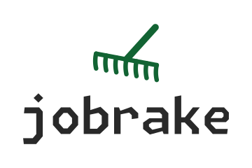

<div align="center">
  <picture>
    <source media="(prefers-color-scheme: light)" srcset="https://raw.githubusercontent.com/eyayaw/jobrake/refs/heads/main/docs/assets/logo/svg/jobrake-stacked-color.svg">
    <source media="(prefers-color-scheme: dark)" srcset="https://raw.githubusercontent.com/eyayaw/jobrake/refs/heads/main/docs/assets/logo/svg/jobrake-stacked-dark.svg">
    
  </picture>
</div>

___The job boards shed new postings every day. Bring a rake.___

jobrake is a Python package and CLI tool for fetching job postings from LinkedIn, Indeed,
EconJobMarket, and employers' boards on [major](#supported-job-boards) applicant tracking systems.
It returns each posting as a record with the same fields, whichever site it came from.

> Read it as "**job-rake**".
>
> Say it quickly and you hear "**job break**"—a break from the search doomscroll. (^_~)
>
> _Did **Jo** show up? **Jo** hit the **brake**, too._

<table>
<tr>
<td valign="top" width="50%">

```sh
jobrake linkedin search \
  --query "data scientist" \
  --location "amsterdam, netherlands" \
  --max-age-hours 48 \
  --results 5 \
  --details
```

</td>
<td valign="top" width="50%">

```sh
jobrake greenhouse search \
  --board anthropic
```
</td>
</tr>
</table>

A sample record from a LinkedIn posting fetched with jobrake:

```json
{
  "site": "linkedin",
  "id": "4447222173",
  "url": "https://www.linkedin.com/jobs/view/data-scientist-smb-ads-growth-at-openai-4447222173",
  "title": "Data Scientist, SMB Ads Growth",
  "company": "OpenAI",
  "locations": [
    {
      "name": "San Francisco, CA",
      "city": "San Francisco",
      "region": "CA",
      "country_code": "US",
      "latitude": 37.78008,
      "longitude": -122.42016
    }
  ],
  "date": "2026-11-13",
  "description": "About The Role\nOpenAI's ads platform is experiencing rapid global scale. ...",
  "company_url": "https://www.linkedin.com/company/openai",
  "company_logo": "https://media.licdn.com/dms/image/v2/D560BAQHpzXbqSyR74A/company-logo_200_200/...",
  "employment_type": "full_time",
  "salary_min": 293000,
  "salary_max": 515000,
  "salary_currency": "USD",
  "salary_period": "YEAR",
  "posted_at": "2026-11-13T14:15:13.000Z",
  "expires_at": "2027-01-26T23:14:46.000Z",
  "apply_type": "offsite",
  "applicants": 200,
  "experience_months": 60,
  "education": "bachelor degree"
}
```

The description and the logo URL are not fully displayed for brevity.
The [reference](https://github.com/eyayaw/jobrake/blob/main/docs/reference.md#returned-fields) describes every key.

## Installation

jobrake is not on PyPI. Install it from GitHub with [`uv`](https://github.com/astral-sh/uv):

```sh
# Try it without installing
uvx --from git+https://github.com/eyayaw/jobrake jobrake -h
# Install as a CLI tool
uv tool install git+https://github.com/eyayaw/jobrake
# Add it to a project as a library
uv add git+https://github.com/eyayaw/jobrake
```

Releases before 1.0 can break the API, so pin a tag in a project:
`uv add git+https://github.com/eyayaw/jobrake --tag <tag>`.
The [changelog](https://github.com/eyayaw/jobrake/blob/main/CHANGELOG.md) marks each breaking change.

## Usage

### CLI

```sh
jobrake -h

# LinkedIn ----
## Search
jobrake linkedin search \
        -q "research economist" \
        -l "London, England" \
        -n 5 \
        -a 24 \
        -d \
        -o jobs.csv

## Fetch details
# You can pass several urls/ids
jobrake linkedin postings \
        "https://uk.linkedin.com/jobs/view/senior-data-scientist-at-hm-treasury-4461975556"
        # or just 4461975556
## Resolve place names
jobrake linkedin places "amsterdam" # then use the display name in search
                                    # -l "Amsterdam, North Holland, Netherlands"
# Use the geoId of the place directly (instead of location)
jobrake linkedin search -q "data scientist" -g 102011674 -n 2 # Amsterdam, Netherlands

# Indeed ----
## Search and fetch details
jobrake indeed search \
        -q "data analyst" \
        -c gb \
        -l "London" \
        -n 5 \
        -a 24 \
        -o jobs.jsonl
# Resolve place names
jobrake indeed places -c nl "amsterdam"

# Greenhouse ----
## Every posting on one employer's board
jobrake greenhouse search -b airbnb -o airbnb.csv

# EconJobMarket ----
## Every open ad
jobrake econjobmarket search -o ejm.csv
```

The CLI writes JSON to stdout by default.
`--format | -f` selects JSON, JSONL, or CSV, and `--output | -o` writes to a file.
See the [guide](https://github.com/eyayaw/jobrake/blob/main/docs/guide.md#read-and-save-results) for file formats and piping,
and the [reference](https://github.com/eyayaw/jobrake/blob/main/docs/reference.md) for returned fields.

### As a library

```python
import asyncio

from jobrake import scrape


async def main():
    return await scrape(
        "indeed",
        query="economist",
        country="us",
        results=2,
    )


jobs = asyncio.run(main())
```

## Supported job boards

| Site | Search | Posting details |
| --- | --- | --- |
| <a href="https://www.ashbyhq.com"> `ashby`</a> | Public Job Posting API, one employer's board | Included in search results |
| <a href="https://econjobmarket.org"> `econjobmarket`</a> | Public ad feed, every open ad | Included in search results |
| <a href="https://www.greenhouse.com"> `greenhouse`</a> | Public Job Board API, one employer's board | Included in search results |
| <a href="https://www.indeed.com"><picture><source media="(prefers-color-scheme: light)" srcset="https://raw.githubusercontent.com/eyayaw/jobrake/refs/heads/main/docs/assets/sites/indeed-light.svg"><source media="(prefers-color-scheme: dark)" srcset="https://raw.githubusercontent.com/eyayaw/jobrake/refs/heads/main/docs/assets/sites/indeed-dark.svg"></picture> `indeed`</a> | Mobile-app GraphQL API | Included in search results |
| <a href="https://www.lever.co"> `lever`</a> | Public Postings API, one employer's board | Included in search results |
| <a href="https://www.linkedin.com/jobs"><picture><source media="(prefers-color-scheme: light)" srcset="https://raw.githubusercontent.com/eyayaw/jobrake/refs/heads/main/docs/assets/sites/linkedin-light.svg"><source media="(prefers-color-scheme: dark)" srcset="https://raw.githubusercontent.com/eyayaw/jobrake/refs/heads/main/docs/assets/sites/linkedin-dark.svg"></picture> `linkedin`</a> | Login-free guest API | Optional, paced, and cached |
| <a href="https://www.smartrecruiters.com"> `smartrecruiters`</a> | Public Posting API, one employer's board | Optional, one request per posting |
| <a href="https://www.workable.com"> `workable`</a> | Public widget API, one employer's board | Included in search results |
| <a href="https://www.workday.com"> `workday`</a> | Career site JSON API, one employer's career site | Optional, one request per posting |

The employer-board sites require `board`: the employer's token, or for Workday the career site URL.
Indeed requires `country`. LinkedIn requires `location` or a geoId.
See the [guide](https://github.com/eyayaw/jobrake/blob/main/docs/guide.md) for search queries, geography, filters, and
detail fetching, and the [reference](https://github.com/eyayaw/jobrake/blob/main/docs/reference.md#requests-by-site)
for pagination, rate limits, and retries.

> [!WARNING]
> LinkedIn answers posting pages with [HTTP 999](https://http.dev/999) from data center IPs, such as a Hetzner VPS.
> Searches still work there, but `--details` and `jobrake linkedin postings` return no details.
> So use jobrake from the comfort of your home. :D

## Contributing

Issues and pull requests are welcome.
[`AGENTS.md`](https://github.com/eyayaw/jobrake/blob/main/AGENTS.md) describes the layout and the design rules.
Before a pull request, run `prek run --all-files` with [prek](https://github.com/j178/prek) installed, as CI does.

## Disclaimer

> [!WARNING]
> jobrake has no affiliation with any of the [supported sites](#supported-job-boards).
> Use it for your own job search, not to collect postings at scale or republish them.
> Scraping may violate their ToS, and any of them may rate-limit or block your IP address.
> EconJobMarket offers its ad feed for personal use and academic research,
> and redisplaying its ads on your own website needs its approval.
> You are responsible for checking and complying with their terms.

---

jobrake's Indeed and LinkedIn searches were inspired by
[python-jobspy](https://pypi.org/project/python-jobspy/). Huge thanks.
